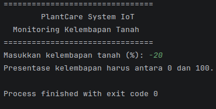
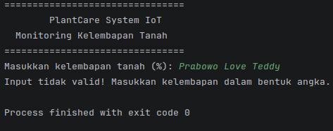
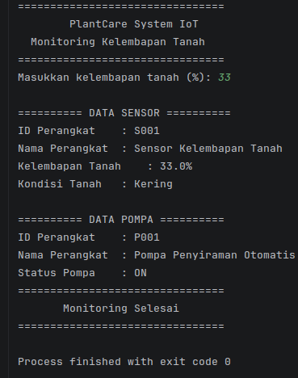
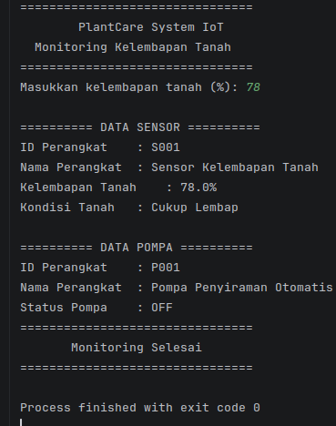

# PlantCare Sistem Monitoring Kelembapan Tanah Sederhana

**Responsi Pemrograman Berbasis Objek (PBO)**

## Identitas

Nama: Muhammad Hafizh Alzaqi  
NIM: H1D025165  
Shift Awal: H  
Shift Akhir: B  
Tema: IoT

## Deskripsi Proyek

PlantCare merupakan program simulasi berbasis console untuk memantau kelembapan tanah dan mengendalikan pompa air secara otomatis. Nilai kelembapan dimasukkan oleh pengguna, kemudian dibandingkan dengan batas kelembapan 40% untuk menentukan apakah pompa menyala atau mati. Program ini tidak menggunakan perangkat IoT fisik.

## Alur Program

### 1. Inisialisasi Program

Program dijalankan melalui class Main.java menggunakan method void main(). Program membuat dua objek perangkat IoT:

- SensorKelembapan dengan ID S001 untuk membaca dan menentukan kondisi kelembapan tanah.
- PompaAir dengan ID P001 untuk mengendalikan status pompa berdasarkan kondisi tanah.

Objek sensor dihubungkan dengan pompa melalui constructor agar pompa dapat mengetahui kondisi tanah. Setelah itu, nama kedua perangkat diatur menggunakan method setNamaPerangkat().

### 2. Input dan Validasi Kelembapan Tanah

Setelah menampilkan judul PlantCare System IoT, program meminta pengguna memasukkan persentase kelembapan tanah melalui console menggunakan IO.readln(). Input kemudian dikonversi menjadi tipe data double menggunakan Double.parseDouble().
Sebelum diproses, program memeriksa nilai yang dimasukkan:

- Jika input berupa angka dalam rentang 0–100%, proses monitoring dilanjutkan.
- Jika input kurang dari 0% atau lebih dari 100%, program menampilkan pesan kesalahan.
- Jika input bukan berupa angka, kesalahan ditangani melalui catch (NumberFormatException e).
- Nilai NaN dan tak hingga juga ditolak.

Jika input tidak valid, program menghentikan proses monitoring.

### 3. Proses Monitoring Kelembapan Tanah

Setelah input valid, nilai kelembapan disimpan ke objek sensor melalui method setKelembapanTanah(). Selanjutnya, program memanggil sensor.jalankan() untuk menentukan kondisi tanah menggunakan percabangan if-else.
Batas kelembapan ditentukan melalui konstanta BATAS_KELEMBAPAN sebesar 40% pada class KonfigurasiIoT.

- Jika kelembapan kurang dari 40%, tanah dianggap kering dan atribut tanahKering berubah menjadi true.
- Jika kelembapan 40% atau lebih, tanah dianggap cukup lembap dan atribut tanahKering berubah menjadi false.

Perubahan kondisi tanah dilakukan melalui method setTanahKering().

### 4. Proses Pengendalian Pompa Air

Setelah kondisi tanah ditentukan, program memanggil pompa.jalankan(). Pompa membaca kondisi tanah dari objek sensor melalui getSensorKelembapan() dan isTanahKering().

- Tanah kering (true): Method nyalakan() dipanggil sehingga status pompa menjadi ON.
- Tanah cukup lembap (false): Method matikan() dipanggil sehingga status pompa menjadi OFF.

Kedua method tersebut merupakan implementasi interface Pengendalian, sedangkan perubahan status pompa dilakukan melalui setStatusPompa(). Pada program ini, pompa masih berupa simulasi dan belum terhubung dengan perangkat fisik.

### 5. Menampilkan Hasil Monitoring

Program menampilkan informasi sensor dan pompa menggunakan method tampilkanData() dari interface Monitoring:

- Sensor: ID perangkat, nama perangkat, persentase kelembapan tanah, dan kondisi tanah.
- Pompa: ID perangkat, nama perangkat, dan status pompa (ON/OFF).

Kedua perangkat menggunakan super.tampilkanInfo() untuk menampilkan informasi dasar dari superclass PerangkatIoT. Pemanggilan tampilkanData() melalui variabel bertipe Monitoring juga menunjukkan penerapan polimorfisme interface.

### 6. Menampilkan Status Akhir

Setelah seluruh informasi ditampilkan, program mencetak pesan Monitoring Selesai dan proses berakhir.
Sebagai contoh, apabila kelembapan tanah sebesar 25%, tanah dianggap kering sehingga pompa berstatus ON. Sebaliknya, jika kelembapan sebesar 65%, tanah dianggap cukup lembap sehingga pompa berstatus OFF.
Dengan demikian, program dapat menyimulasikan monitoring kelembapan tanah dan pengendalian pompa secara otomatis berdasarkan input pengguna.

## Fitur Program

1. Input kelembapan tanah: Pengguna dapat memasukkan nilai kelembapan secara manual melalui console sebagai simulasi pembacaan sensor.
2. Validasi input: Memeriksa format angka dan membatasi nilai kelembapan pada rentang 0–100%.
3. Pendeteksian kondisi tanah: Menentukan kondisi tanah berdasarkan batas kelembapan 40%.
4. Pengendalian pompa otomatis: Mengubah status pompa menjadi ON saat tanah kering dan OFF saat tanah cukup lembap.
5. Monitoring perangkat: Menampilkan informasi sensor, hasil pembacaan kelembapan, kondisi tanah, dan status pompa.

## Cara Menjalankan Program

Prasyarat: JDK 25 atau lebih baru.
Jalankan perintah berikut dari direktori utama proyek.

### 1. Masuk ke direktori src

```bash
cd src/
```

### 2. Kompilasi program

```bash
javac *.java
```

### 3. Jalankan program

```bash
java Main
```

## Hasil Output

### 1. Ketika Input Tidak Sesuai



### 2. Ketika Input Tidak Sesuai dengan Format



### 3. Ketika Kelembapan Kurang dari 40%



### 4. Ketika Kelembapan Lebih dari 40%


